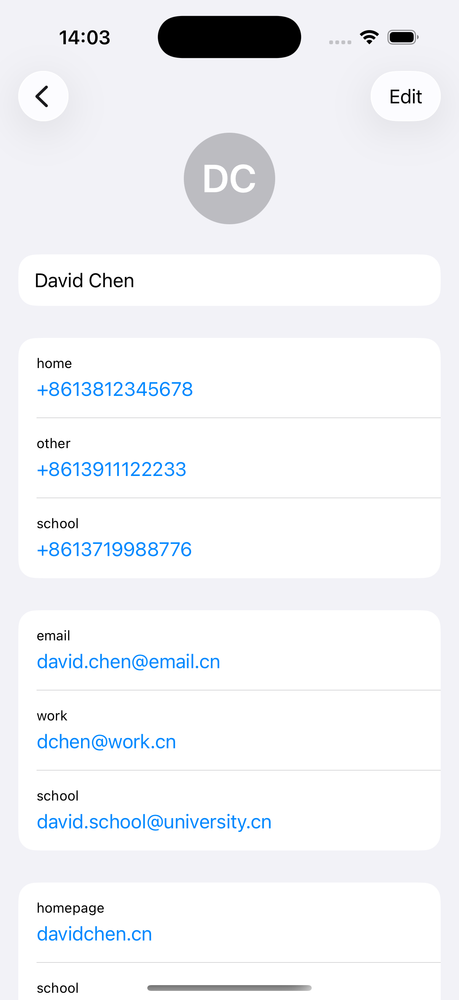
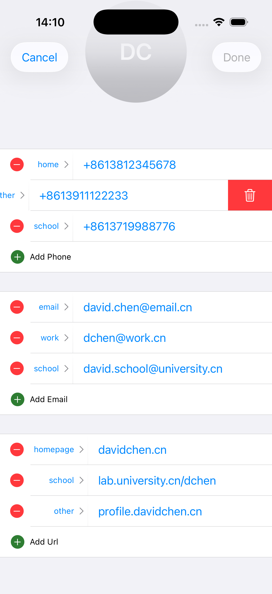
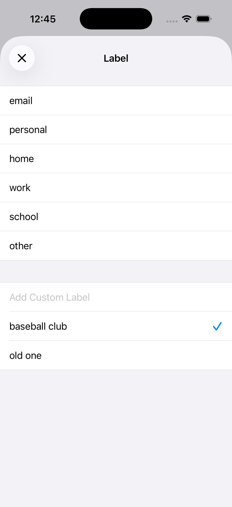

# ContactFieldKit 📇

A SwiftUI package that provides native iOS-style contact field management for phones, emails, and URLs. Built to match the look and feel of Apple's Contacts app.

| Contact details | Edit contact | Pick a label |
|-----------------|--------------|--------------|
|  |  |  |


## Features

- ✅ Display and edit phone numbers, emails, and URLs
- ✅ Native iOS-style interface matching Apple's Contacts app
- ✅ Built-in labels (Home, Work, Mobile, etc.) with custom label support
- ✅ Swipe-to-delete functionality
- ✅ Add/remove contact items dynamically
- ✅ Label picker with common presets
- ✅ `Codable` models for easy persistence
- ✅ Long-press to copy contact values
- ✅ Automatic validation and formatting

## Installation

### Swift Package Manager

Add ContactFieldKit to your project via Xcode:

1. File → Add Package Dependencies
2. Enter package URL: `https://github.com/BaptisteSansierra/ContactFieldKit`
3. Select version and add to your target

Or add it to your `Package.swift`:
```swift
dependencies: [
    .package(url: "https://github.com/BaptisteSansierra/ContactFieldKit", from: "1.0.0"),
    .package(url: "https://github.com/BaptisteSansierra/NoFlyZone", from: "1.0.0")
]
```

## Usage

### Basic Setup
```swift
import SwiftUI
import ContactFieldKit

struct ContactView: View {
    @State private var phones: [ContactItem] = [
        .phone("+12125550112", label: .home),
        .phone("+13105557834", label: .mobile),
        .phone("+14155559021", label: .work),
        .phone("+16175551276", label: .custom("assistant"))
    ]
    
    @State private var emails: [ContactItem] = [
        .email("alice.johnson@email.com"),
        .email("alice.home@example.com", label: .home),
        .email("alice.work@company.com", label: .work)
    ]
    
    @State private var urls: [ContactItem] = [
        .url("alicejohnson.com", label: .homepage),
        .url("intranet.company.com/alice", label: .work)
    ]
    
    var body: some View {
        VStack {
            ContactItemView(contactItems: $phones)
            ContactItemView(contactItems: $emails)
            ContactItemView(contactItems: $urls)
        }
    }
}
```

### Display Mode (Read-Only)

Use `ContactItemView` to display contact information:
```swift
ContactItemView(contactItems: $phones)
```

Features:
- Tap phone numbers to call
- Tap emails to compose
- Tap URLs to open in browser
- Long-press any value to copy

### Edit Mode

Use `ContactItemEditView` for full editing capabilities. It works on `ContactItemUI`, a wrapper holding the row's layout state around each `ContactItem`:
```swift
@State private var phones: [ContactItemUI] = user.phones.map { ContactItemUI(contactItem: $0) }
@State private var noFlyZoneEnabled = false
@State private var noFlyZoneCompletionStatus: NoFlyZoneCompletionStatus = .undefined
@State private var noFlyAuthorizedZones: [NoFlyZoneData] = []

ContactItemEditView(
    viewIdentifier: 1,
    kind: .phone,
    values: $phones,
    noFlyZoneEnabled: $noFlyZoneEnabled,
    noFlyZoneCompletionStatus: $noFlyZoneCompletionStatus,
    noFlyAuthorizedZones: $noFlyAuthorizedZones
)

// Back to the model
let edited = phones.map(\.contactItem)
```

Features:
- Add new contact items
- Swipe to delete items
- Edit values inline
- Change labels via picker
- Automatic keyboard types per field type

### ContactItem Model

A `ContactItem` is a value with a label, like in Apple's Contacts app (`mobile: +1345678`). Each kind (phone, email, URL) has its own label type, so a label that doesn't belong to the kind doesn't compile:
```swift
let phone = ContactItem.phone("+1234567890", label: .mobile)
let email = ContactItem.email("user@example.com", label: .work)
let url = ContactItem.url("example.com", label: .homepage)

// The label defaults to the kind's generic one (.phone / .email / .url)
let other = ContactItem.phone("+1234567890")

// ContactItem.phone("+1234567890", label: .homepage) // ❌ doesn't compile

phone.kind   // .phone
phone.label  // .phone(.mobile)
```

### Available Labels

ContactFieldKit provides standard labels that match Apple's Contacts app. Each kind has its own labels, plus the shared ones:

| Kind | Label type | Specific labels |
|------|------------|-----------------|
| Phone | `PhoneLabel` | `.phone`, `.mobile` |
| Email | `EmailLabel` | `.email`, `.personal` |
| URL | `URLLabel` | `.url`, `.homepage` |

**Shared labels** (available for every kind): `.home`, `.work`, `.school`, `.other`, and `.custom(String)` for custom labels.

Shared labels are `SharedLabel` cases: `.home` is a shortcut for `.shared(.home)`.

Custom labels created in the label picker are remembered (per kind) and offered again the next time.

### Persistence

`ContactItem` is `Codable`. It encodes to a flat, versioned JSON object:
```json
{ "version": 1, "id": "…", "kind": "phone", "label": "mobile", "value": "+1234567890" }
```
A custom label is stored as its text (`"label": "assistant"`).

```swift
// Encode / decode
let data = try JSONEncoder().encode(phones)
let decodedPhones = try JSONDecoder().decode([ContactItem].self, from: data)

// Store a single item as a string (e.g. in a database)
let raw = phone.rawValue
let restored = ContactItem(rawValue: raw)   // nil if it can't be decoded
```

Decoding rules:
- No `version` means the legacy format (before versioning, `"label": {"kind": "phone", "value": {"mobile": {}}}`). It's still read, and the item is written back as version 1 on its next encoding. In that format a custom label stays custom even when named like a built-in one, and a label of another kind becomes a custom one.
- An unsupported `version` throws `ContactItemError.droppedVersion`, and a version newer than the package throws `ContactItemError.unknownVersion`.
- An unknown `kind` throws `ContactItemError.unknownKind`.
- An unknown label name decodes as a custom label, so a label added in a future version still shows up in an older one.
- A custom label whose text is a built-in label name of the same kind (e.g. `"home"` for a phone) decodes as that built-in label.

## Testing

The package has a test suite (Swift Testing) covering the models, the encoding, the labels and the services.

The package uses UIKit, so the tests run on an iOS simulator (`swift test` doesn't work):
- **Xcode:** open the package, pick an iOS simulator as destination, then Product → Test (⌘U).
- **Terminal:**
```sh
xcodebuild test -scheme ContactFieldKit -destination 'platform=iOS Simulator,name=iPhone 17 Pro'
```

## Dependencies

ContactFieldKit uses [NoFlyZone](https://github.com/BaptisteSansierra/NoFlyZone) for swipe-to-delete functionality with interaction blocking.

## Requirements

- iOS 17.0+
- Swift 6.2+ (Xcode 26+)

## Example Project

Check out the [Example](Examples/) folder for a complete demo app showing:
- Contact detail views
- Contact editing with multiple field types
- Label customization

## License

ContactFieldKit is available under the MIT license. See the LICENSE file for more info.

## Author

Baptiste Sansierra - [@BaptisteSansierra](https://github.com/BaptisteSansierra)

---

⭐️ If you find ContactFieldKit useful, please give it a star on GitHub!
